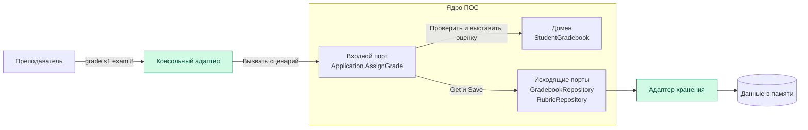

# ПОС — преподавательская оценка студентов

Домашнее задание № 2 по конструированию программного обеспечения. ПОС — консольное приложение для ведения оценок на одном курсе. В нём можно добавлять студентов и критерии, выставлять, исправлять и отменять оценки, рассчитывать взвешенные итоги и выгружать их в CSV.

## 1. Запуск и демонстрация

Нужен Go 1.22 или новее. Запустите приложение из корня проекта.

```sh
go run .
```

При запуске приложение показывает список команд. Его можно повторно открыть командой `help`. Вводите по одной команде на строку. Вес задаётся долей от 0 до 1, дробные числа вводятся через точку, ФИО и названия с пробелами вводятся без кавычек. Команда `exit` завершает сеанс.

В свежем сеансе введите следующие команды. Они добавляют студента и два критерия, показывают списки и оценки, рассчитывают итог и создают `results.csv` в текущем каталоге.

```text
student-add s1 Анна Иванова
criterion-add exam 10 0.6 Экзамен
criterion-add project 20 0.4 Проект
students
criteria
grade s1 exam 8
grade s1 project 10
grades s1
score s1
export results.csv
```

Команда `score s1` выведет `Анна Иванова (s1): окончательный итог 68`. В CSV будут заголовок и строка студента.

```csv
student_id,full_name,final_score
s1,Анна Иванова,68
```

В том же сеансе можно проверить исправление и отмену оценки.

```text
grade-change s1 exam 9
score s1
grade-cancel s1 project
score s1
score s1 preliminary
exit
```

После исправления итог станет `74`. После отмены оценки за проект окончательный расчёт сообщит, что оценка отсутствует, а предварительный вернёт `54`. Экспорт фиксирует результат на момент вызова команды. Студенты, критерии и оценки хранятся в памяти и теряются при завершении сеанса. Выгруженный CSV остаётся на диске.

## 2. Доменная модель (DDD)

Термины предметной области используются в командах и в коде. Студент — `Student`, критерий — `Criterion`, оценка — `Grade`, рубрикатор — `Rubric`, ведомость студента — `StudentGradebook`, итог — `FinalScore`.

| Элемент модели | Роль |
| --- | --- |
| `Student`, `Criterion` | **Entity.** Идентичность определяется ID. Например, при смене ФИО студент остаётся тем же. Критерий сохраняет ID при изменении веса. |
| `Grade` | **Value Object.** Оценка описывается критерием, баллом и необязательной датой выставления в контексте ведомости. Собственного ID у неё нет. Внешний код получает оценку по значению. Исправление выполняет сама ведомость. |
| `StudentGradebook` | **Корень агрегата ведомости.** Объединяет одного студента и его оценки. Через ведомость оценку можно выставить, изменить или отменить. Репозиторий обращается к ведомости по ID студента. |
| `Rubric` | **Корень агрегата рубрикатора.** Содержит критерии курса и следит за уникальностью их ID и суммой весов. Один рубрикатор используется для всех ведомостей. |
| `FinalScoreCalculator` | **Domain Service.** Для расчёта нужны и ведомость, и текущий рубрикатор. Сервис возвращает вычисленный результат `FinalScore` для студента. |

### Инварианты и расчёт

- `StudentGradebook` разрешает выставить или изменить балл только по критерию из текущего рубрикатора. Балл должен лежать в диапазоне от 0 до максимума включительно. По каждому критерию в ведомости может быть только одна оценка.
- Максимум критерия — положительное конечное число, вес лежит от 0 до 1. Рубрикатор отклоняет повторяющийся ID критерия и сумму весов больше 1 с учётом погрешности `float64`.
- Итог каждый раз вычисляется из текущих оценок и весов. Вклад критерия равен `балл / максимум × вес × 100`. В первом примере это `8 / 10 × 0.6 × 100 + 10 / 20 × 0.4 × 100 = 68`.

Режим `official` используется по умолчанию и требует оценку по каждому критерию рубрикатора. Режим `preliminary` считает вклад выставленных оценок, оставляя пропускам нулевой вклад. Оба режима используют заданные веса без нормализации. При сумме весов меньше 1 даже максимальные оценки дадут итог меньше 100. Для пустого рубрикатора текущая реализация возвращает 0 в обоих режимах.

## 3. Архитектура и внедрение зависимостей

Проект использует **Ports and Adapters**.

### Как команда проходит через порты

На схеме показано, кто кого вызывает при выполнении команды `grade s1 exam 8`.



Консоль разбирает команду и вызывает метод фасада `Application.AssignGrade`. Метод загружает ведомость и рубрикатор через исходящие порты, передаёт их домену для проверки и выставления оценки, затем сохраняет ведомость. Если проверка возвращает ошибку, консоль показывает её преподавателю, а сохранение пропускается.

Экспорт работает по той же схеме. Команда `export` вызывает `Application.ExportResults`, а приложение передаёт рассчитанные итоги через порт `ResultsExporter` адаптеру `csvexport`, который записывает файл.

### Зависимости пакетов

Стрелка в таблице читается как «пакет слева импортирует пакет справа».

| Импорт в коде | Для чего нужен |
| --- | --- |
| `adapters/console → application` | Вызвать сценарии приложения. |
| `adapters/console → adapters/csvexport` | Создать CSV-адаптер для пути, указанного в команде. |
| `application → domain` | Работать с доменной моделью и вызывать её методы. |
| `adapters/memory → domain` | Использовать типы `StudentGradebook` и `Rubric` в методах хранения. |
| `adapters/csvexport → domain` | Принять результаты типа `FinalScore` для записи в CSV. |

В Go интерфейс реализуется совпадением сигнатур методов. Поэтому адаптеры хранения и экспорта могут реализовать порты `application`, импортируя только пакет с типами из этих сигнатур.

| Слой | Ответственность |
| --- | --- |
| [`domain/`](domain/) | Доменная модель, инварианты и расчёт итогов. Зависит только от стандартной библиотеки Go. |
| [`application/`](application/) | Сценарии приложения и исходящие порты `GradebookRepository`, `RubricRepository` и `ResultsExporter`. Например, выставление оценки загружает ведомость и рубрикатор, передаёт проверку домену и сохраняет обновлённую ведомость. |
| [`adapters/`](adapters/) | `console` разбирает команды и вызывает сценарии `Application`. `memory` реализует репозитории. `csvexport` реализует экспорт. Консоль создаёт CSV-адаптер с путём из команды и передаёт его приложению через порт `ResultsExporter`. |

[`di.go`](di.go) — точка сборки приложения. Контейнер `go.uber.org/dig` связывает порты репозиториев с реализациями в памяти, передаёт приложению два калькулятора с разными стратегиями и создаёт консоль с потоками ввода и вывода. [`main.go`](main.go) запускает собранное приложение.

## 4. Паттерны GoF

| Группа и паттерн | Где применён | Какую задачу решает |
| --- | --- | --- |
| Порождающий — **Prototype** | `Rubric.Clone`, `StudentGradebook.Clone` | Репозитории копируют состояние при чтении и сохранении. Сценарий работает со своей копией, поэтому изменение полученной ведомости или рубрикатора отражается в хранилище только после `Save`. |
| Структурный — **Facade** | `application.Application` | Консоль вызывает методы сценариев через единый интерфейс работы с приложением. Порядок загрузки данных, вызова домена и сохранения задаёт сам сценарий. |
| Поведенческий — **Strategy** | `ScoreStrategy`, `OfficialScoreStrategy`, `PreliminaryScoreStrategy` | Один доменный сервис поддерживает две политики обработки пропущенных оценок. Стратегии используют общую формулу взвешенного итога. |

## 5. Тесты

Из корня проекта выполните `go test ./...`. Для вывода названий тестов и их результатов используйте `go test -v ./...`.

- [`TestAssignGradeBounds`](tests/student_gradebook_test.go) проверяет границы допустимых баллов, дробные значения, `NaN` и бесконечность.
- [`TestAssignGradeRejectsUnknownAndDuplicateCriterion`](tests/student_gradebook_test.go) проверяет запрет оценки по неизвестному критерию и повторного выставления оценки.
- [`TestFinalScoreReflectsGradeChanges`](tests/final_score_calculator_test.go) проверяет взвешенный итог, пересчёт после исправления и поведение обоих режимов после отмены оценки.

## 6. Политика использования ИИ

Автор самостоятельно спроектировал архитектуру проекта и доменную модель, выбрал паттерны GoF и определил, где и зачем их применять.

Под руководством автора ИИ сгенерировал код для файлов [`console.go`](adapters/console/console.go), [`application.go`](application/application.go) и [юнит-тесты](tests/). Автор определял, какие функции нужны и как должна работать каждая из них.

ИИ также проверял и корректировал код в пакете [`domain`](domain/). В частности, он помог уточнить проверки входных данных и обработку случаев, в которых могли нарушаться инварианты. Автор сформулировал эти инварианты при проектировании доменной модели.

Все комментарии в коде написаны ИИ.